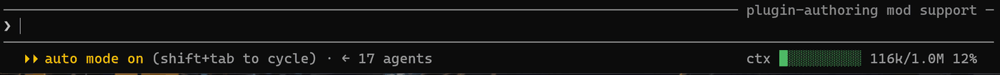

# context-meter

在 Claude Code 里实时显示当前上下文（context window）的使用长度。



- **输入框下面、靠右下**：画在 prompt footer 右侧（引擎模式标签 `focus` / `memory paused` 的位置），10 格进度条 + 已用/窗口 token 数 + 百分比，颜色随占用变化（绿 <70%、黄 70–90%、红 ≥90%）。

数据来自 `$.session.usage()`（与状态行同源，零 API 开销），在 `session.start`、`prompt.submit`、`turn.complete`、`session.compact` 后自动刷新；首轮回复前显示 `—`（该数字要等第一个响应才有）。

## 安装

从 GitHub（公开仓库）安装，在 Claude Code 终端会话里输入：

```text
/plugin install context-meter --marketplace zhongliuyang6/context-meter
```

或从 shell：

```text
claude plugin install context-meter --marketplace zhongliuyang6/context-meter
```

本地开发运行：`claude --plugin-dir <本目录>`，或在会话中按提示开启本会话写的 mods。

## English

context-meter is a Claude Code mod that shows how full the context window is.
It draws a colored 10-cell progress bar below the input box, at the right of
the prompt footer where the engine's mode labels sit: used tokens over window
size and a percentage. Figures come from `$.session.usage()` and refresh on
session start, prompt submit, turn complete and compaction. No setup needed.
